# ResolveAI – AI-Powered Customer Support & Ticket Management System

ResolveAI is a full-stack customer support platform that combines ticket management, AI-assisted troubleshooting, and knowledge-base retrieval to simplify customer support operations.

Customers can register, log in, submit support tickets, and track their issue status. Administrators can manage customer issues, update ticket statuses, and use an AI-powered assistant to retrieve relevant troubleshooting information.

## 🚀 Live Demo

- **Live Application:** https://resolveai-frontend-pp8b.onrender.com
- **Backend:** https://resolveai-backend-shjb.onrender.com
- **GitHub Repository:** https://github.com/srashtishukla-dev/ResolveAI

## ✨ Key Features

### 👤 Customer Module
- Customer registration and login.
- Customer dashboard.
- Create and submit support tickets.
- View submitted support requests.
- Track ticket status and progress.

### 🛠️ Admin Module
- Admin login and dashboard.
- View customer support tickets.
- Manage customer problems.
- Monitor ticket priority and status.
- Update ticket status as work progresses.
- Mark tickets as resolved.

### 🤖 AI Support Assistant
- AI-powered support assistant in the admin interface.
- Ask questions about customer support issues.
- Knowledge-base document retrieval.
- Retrieve relevant troubleshooting information.
- Support administrators in investigating customer problems.

## 🖥️ Application Screenshots

### 1. Customer Registration

Customers can create an account to access the support platform.

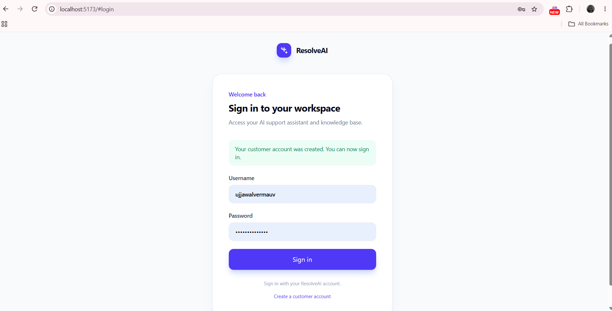

### 2. Customer Account Created

Successful customer account creation.

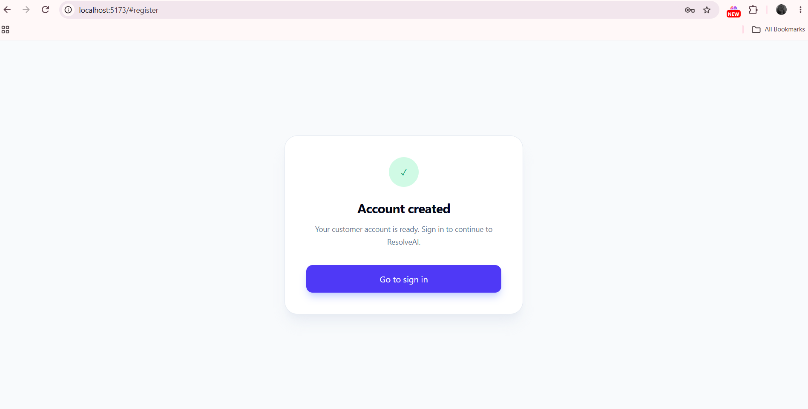

### 3. Customer Dashboard

Customers can access their workspace and manage their support requests.

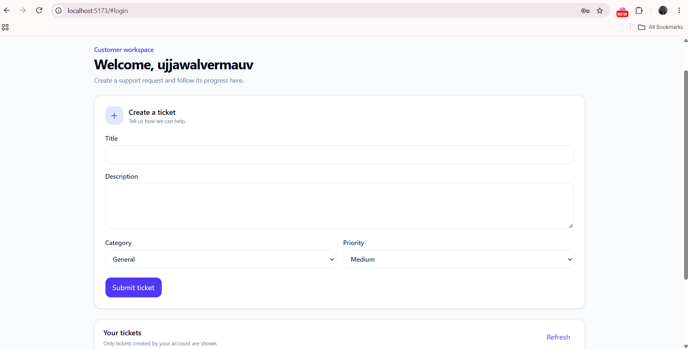

### 4. Customer Ticket Creation

Customers can submit their problems through the ticket creation interface.

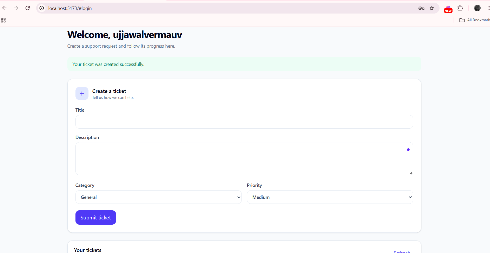

### 5. Customer Ticket Status

Customers can view the progress of their submitted support requests.

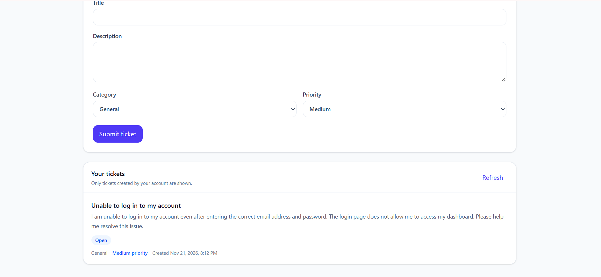

### 6. Admin Login

Administrators can log in to access the management dashboard.

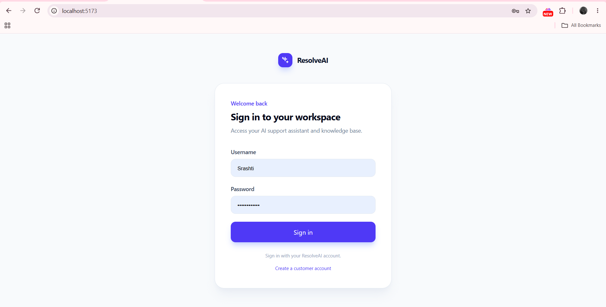

### 7. Admin Dashboard

The admin dashboard provides access to customer support management.

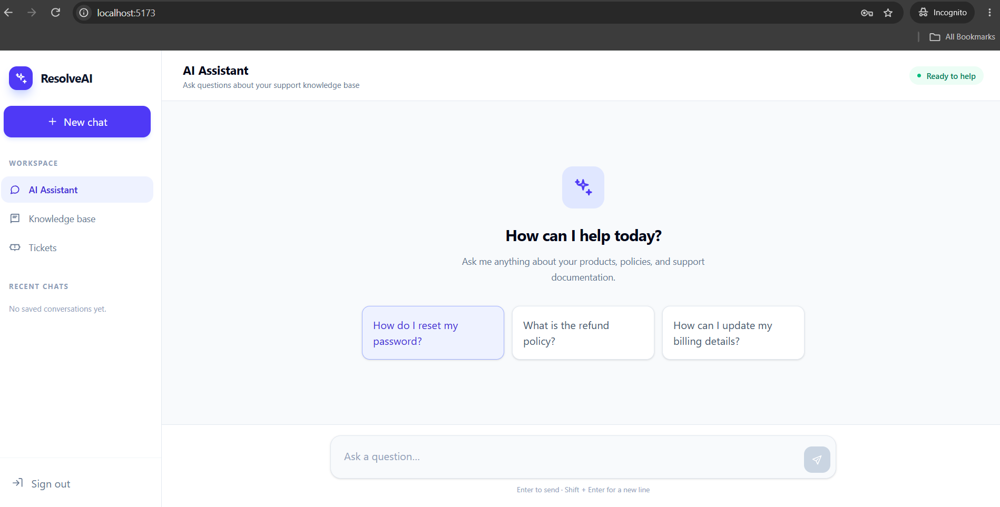

### 8. Admin Ticket Status

Administrators can monitor the status of customer support tickets.

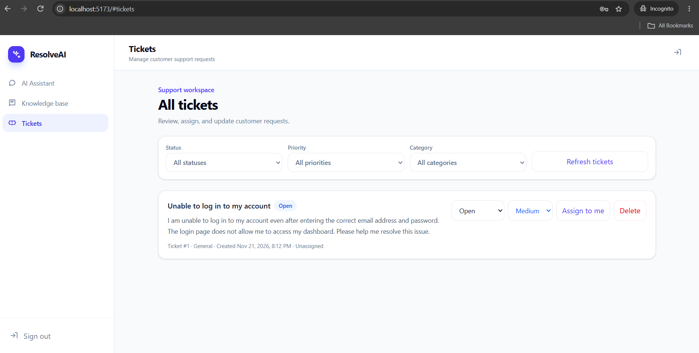

### 9. Admin Changes Ticket Status

Administrators can update ticket statuses as they work on customer problems and resolve issues.

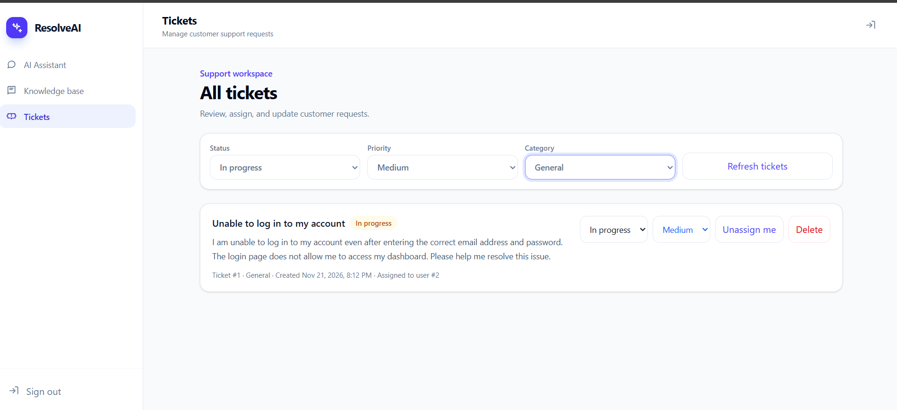

### 10. AI Support Assistant

The admin can interact with the AI support assistant to ask questions about customer problems.

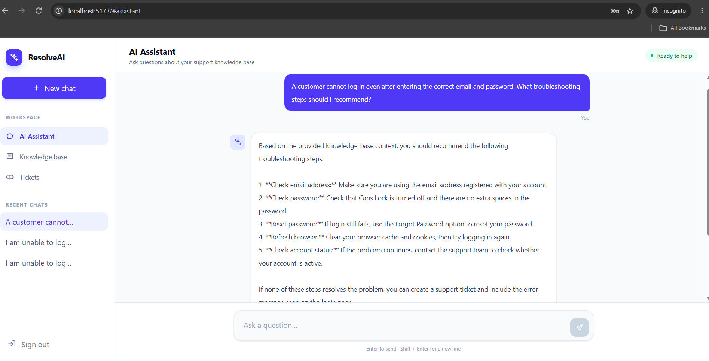

### 11. Knowledge Base

The knowledge base supports AI-assisted retrieval of relevant troubleshooting information.

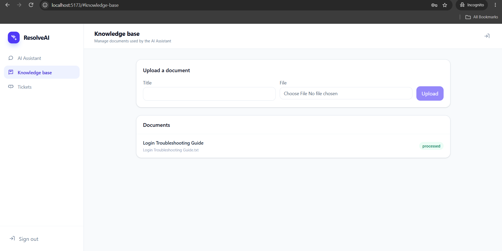

## 🧰 Technology Stack

### Frontend
- React
- TypeScript
- Vite
- Tailwind CSS

### Backend
- Python
- Django
- Django REST Framework

### Database
- PostgreSQL
- pgvector

### AI & Machine Learning
- Sentence Transformers
- Retrieval-Augmented Generation (RAG)
- Google GenAI
- Scikit-learn
- Joblib

### Deployment
- Render

## 🏗️ Project Structure

```text
ResolveAI/
│
├── backend/
│   ├── config/
│   ├── tickets/
│   ├── knowledge_base/
│   ├── manage.py
│   └── requirements.txt
│
├── frontend/
│   ├── src/
│   ├── public/
│   └── package.json
│
├── docs/
│   └── images/
│       ├── customer_register.png
│       ├── customeraccount_created.png
│       ├── customerdashboard.png
│       ├── customerticket_created.png
│       ├── customerticket_status.png
│       ├── admin_login.png
│       ├── admindashboard.png
│       ├── adminticket_status.png
│       ├── adminchange_ticketstatus.png
│       ├── AIsupport.png
│       └── knowelege_base.png
│
└── README.md
```

## ⚙️ Local Installation and Setup

### Prerequisites

- Python
- Node.js and npm
- PostgreSQL

### 1. Clone the Repository

```bash
git clone https://github.com/srashtishukla-dev/ResolveAI.git
cd ResolveAI
```

### 2. Backend Setup

```bash
cd backend
python -m venv venv
```

Activate the virtual environment on Windows:

```powershell
.\venv\Scripts\Activate.ps1
```

Install backend dependencies:

```bash
pip install -r requirements.txt
```

Configure the required environment variables in your backend `.env` file, including Django settings, PostgreSQL connection details, and required AI provider credentials.

Run database migrations:

```bash
python manage.py migrate
```

Start the Django development server:

```bash
python manage.py runserver
```

Backend runs at:

`http://127.0.0.1:8000/`

### 3. Frontend Setup

Open another terminal:

```bash
cd frontend
npm install
```

Configure the frontend API URL in the frontend environment configuration:

```env
VITE_API_BASE_URL=http://127.0.0.1:8000
```

Start the frontend:

```bash
npm run dev
```

Frontend runs at:

`http://localhost:5173/`

## 🎯 Project Objective

ResolveAI demonstrates the development of a full-stack customer support application that brings together ticket management, AI-assisted troubleshooting, and knowledge-base retrieval.

The goal is to make customer support workflows more organized and help administrators find relevant information when handling customer issues.

## 👩‍💻 Developer

**Srashti Shukla**

- GitHub: https://github.com/srashtishukla-dev
- Project Repository: https://github.com/srashtishukla-dev/ResolveAI

---

⭐ If you find this project interesting, feel free to explore the repository and try the live application!